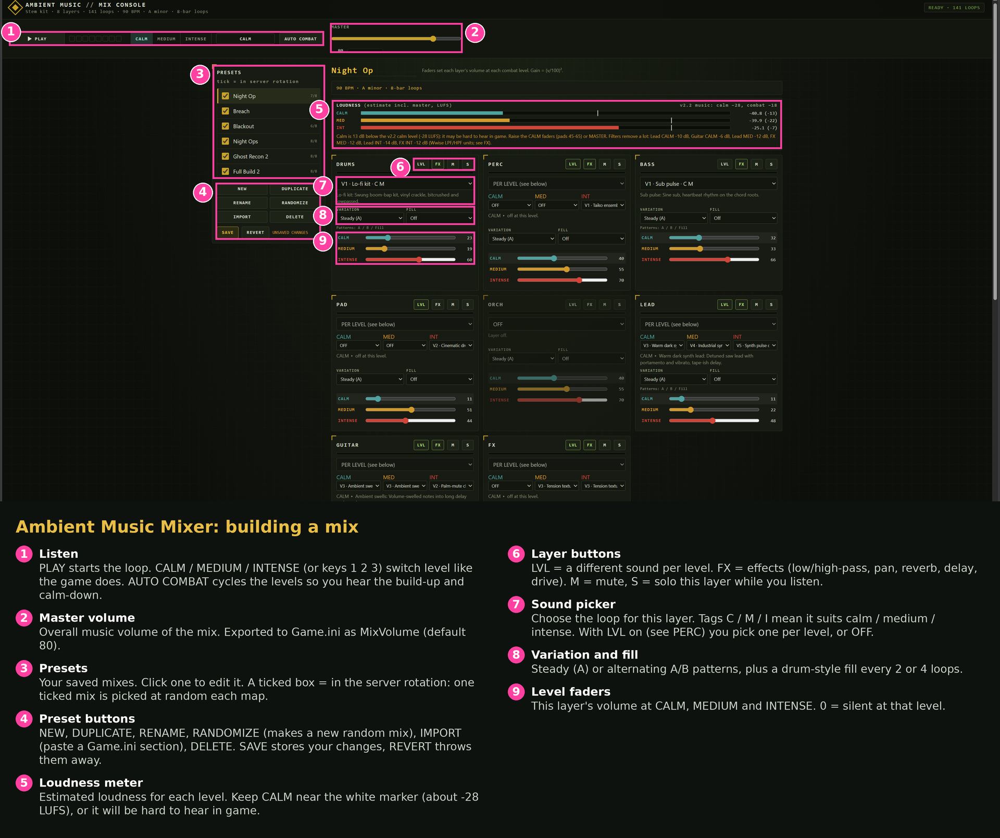
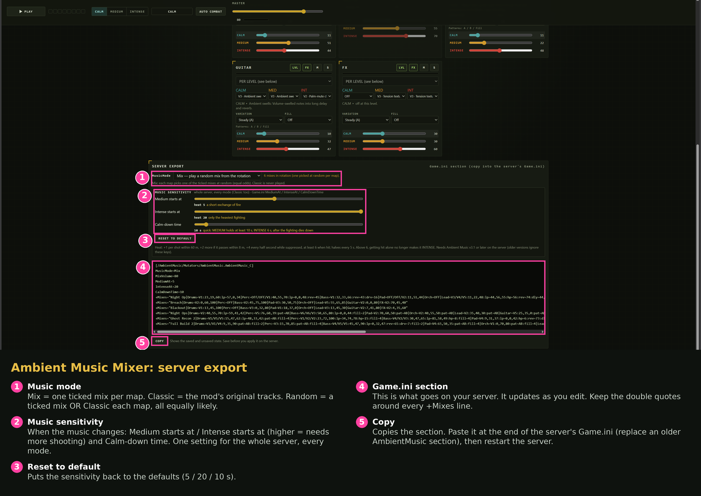

# Ambient Music Mixer: user guide

The Ambient Music Mixer is a small web page that runs on your own PC. With it you build the combat music
for your Insurgency: Sandstorm server: the mod **Ambient Music** (mod.io ID 6488692, mutator `AmbientMusic`)
plays it in game, getting louder and heavier as the fighting heats up.

You don't need anything else: the loops are already inside the mod, so a mix is only a few lines of text
that you paste into your server's `Game.ini`.

- [1. Install](#1-install)
- [2. Start the mixer](#2-start-the-mixer)
- [3. Build a mix](#3-build-a-mix)
- [4. Put it on your server](#4-put-it-on-your-server)
- [5. Music sensitivity](#5-music-sensitivity)
- [6. Troubleshooting](#6-troubleshooting)

---

## 1. Install

1. Open the [latest release](https://github.com/Landon0615/AmbientMusicMixer/releases/latest).
2. Under **Assets**, download **AmbientMusicMixer-v3.1.zip** (about 50 MB, the name may have a newer
   version number). Do **not** use "Source code": it does not contain the loops.
3. Unzip it anywhere, for example to your Desktop. In Windows: right-click the zip > **Extract All**.
   Don't run it from inside the zip.

You get a folder with `Start Mixer.bat`, `start_mixer.sh`, `README.txt`, `LICENSE.txt` and a `mixer` folder.

**Optional: Python.** The mixer works without installing anything. If you have
[Python 3.8 or newer](https://www.python.org/downloads/) installed, your presets are saved in a file
(`mixer\data\music_mixes.json`) instead of in your browser, and you can open the mixer from other PCs on
your network. When you install Python on Windows, tick **"Add python.exe to PATH"**.

## 2. Start the mixer

**Windows:** double-click **Start Mixer.bat**. A black window opens (leave it open) and your browser opens
<http://localhost:8765/>. If Windows SmartScreen warns about the file, click **More info > Run anyway**.

**Linux:** in the unzipped folder run `./start_mixer.sh`, then open <http://localhost:8765/>.
On a headless server, either run `./start_mixer.sh --lan` and open `http://<server-ip>:8765/` from your PC,
or keep the default and tunnel: `ssh -L 8765:localhost:8765 you@yourserver`.

Use a current Chrome, Edge or Firefox. Browsers only play sound after a click, so click **PLAY** once.
To stop the mixer, close the black window (or press Ctrl+C).

## 3. Build a mix



1. **Pick a preset (3)** on the left to start from, or click **NEW** or **RANDOMIZE (4)**.
   The tick boxes choose which presets go to your server: one ticked mix is picked at random each map.
2. Click **PLAY (1)** and use **CALM / MEDIUM / INTENSE** (or keys 1, 2, 3) to hear each combat level.
   **AUTO COMBAT** plays the build-up and calm-down the way the game will.
3. For each of the 8 layers (Drums, Perc, Bass, Pad, Orch, Lead, Guitar, FX):
   - choose a sound in the **sound picker (7)**. The tags C / M / I mean it suits calm / medium / intense;
   - set the three **level faders (9)**: the layer's volume at CALM, MEDIUM and INTENSE (0 = silent);
   - optional: **VARIATION / FILL (8)** for A/B patterns and fills;
   - optional, with the **layer buttons (6)**: **LVL** uses a different sound per level (for example a soft bass
     in calm and a distorted one in intense), **FX** opens effects (low-pass, high-pass, pan, reverb, delay,
     drive), **M** mutes and **S** solos the layer while you listen.
4. Check the **loudness meter (5)**. Keep CALM near the white marker (about -28 LUFS); quieter than that is
   hard to hear in game. **MASTER (2)** sets the overall volume.
5. Click **SAVE (4)**. Unsaved changes are shown next to the button; **REVERT** throws them away.

## 4. Put it on your server



1. Scroll down to **SERVER EXPORT** and choose the **music mode (1)**:
   - **Mix**: one of your ticked mixes each map.
   - **Classic**: the mod's original tracks (the mixer is not used).
   - **Random**: a ticked mix *or* Classic each map, all equally likely. With 6 mixes ticked, Classic plays
     on about 1 map in 7; tick fewer mixes to hear Classic more often.
2. Optional: set the **music sensitivity (2)**, see [below](#5-music-sensitivity).
3. Click **COPY (5)**. This copies the **Game.ini section (4)**.
4. **Stop your server** and open its `Game.ini`:
   - Windows server: `Insurgency\Saved\Config\WindowsServer\Game.ini`
   - Linux server: `Insurgency/Saved/Config/LinuxServer/Game.ini`
5. Paste the section at the end of the file. If there is already a
   `[/AmbientMusic/Mutators/AmbientMusic.AmbientMusic_C]` section, replace it: the section must appear only once.
6. Make sure the server has the mod: subscribe the server to mod **6488692** and add `AmbientMusic` to its
   mutators (for example `-mutators=AmbientMusic`, or your existing mutator list).
7. Start the server. `Game.ini` is only read at start-up, so restart after every change.

Example of what you paste:

```ini
[/AmbientMusic/Mutators/AmbientMusic.AmbientMusic_C]
MusicMode=Mix
MixVolume=80
+Mixes="Night Op|Drums=V1:23,19,60:lp=57,0,34|Perc=Off/Off/V1:40,55,70|..."
```

> **Keep the double quotes** around every `+Mixes` value. Without them the game stops reading at the first
> `|` and the mix is silent. Don't edit recipes by hand: change them in the mixer and copy again.

Edit the server's `Game.ini` only while the server is stopped. The game can rewrite the file when it shuts
down, which drops changes made while it was running.

## 5. Music sensitivity

Needs Ambient Music **v3.1 or later** on the server. These sliders set *when* the music changes, for the
whole server and in every music mode (Classic too). The page writes these keys only when they differ from
the defaults; **RESET TO DEFAULT (3)** removes them again.

| Slider | Game.ini key | Default | Range | Meaning |
|---|---|---|---|---|
| Medium starts at | `MediumAt` | 5 | 0.5-10 | combat heat for MEDIUM (5 = real fighting nearby) |
| Intense starts at | `IntenseAt` | 20 | 1-30, above MediumAt | combat heat for INTENSE (20 = a sustained firefight) |
| Calm-down time | `CalmDownTime` | 10 s | 5-90 s | how long MEDIUM holds before CALM (INTENSE holds 3/5 of it) |

**Combat heat:** +1 for every shot fired within 60 m of you, +2 more if it passes within 8 m, +4 every half
second while you are suppressed, at least 6 when you are hit. It halves every 5 seconds.
Lower values make the music react to less shooting; higher values mean only big fights change it.
With the defaults, getting hit on its own gives MEDIUM, not INTENSE.

Want the older, jumpier v3.0 behaviour? Use `MediumAt=2`, `IntenseAt=5`, `CalmDownTime=20`.

## 6. Troubleshooting

| Problem | Fix |
|---|---|
| No sound in the browser | Click PLAY. Check the browser tab isn't muted and the layer isn't muted (M) or another layer soloed (S). |
| Page doesn't open / "port in use" | Another program uses port 8765. Linux: `./start_mixer.sh --port 8766`. Windows: edit `PORT` in `Start Mixer.bat`. Then open that port. |
| Presets disappear | Without Python they are kept in your browser: use the same browser, and don't clear its site data. Install Python to save them in a file. |
| Mix silent in game | The `+Mixes` lines lost their double quotes, the section is in the file twice, or the server wasn't restarted. |
| Server still plays the old music | The server isn't running `MusicMode=Mix` or `Random`, or `Game.ini` was edited while the server was running. Stop the server, check the section, start it again. |
| Calm is hard to hear | Raise the CALM faders (pads around 45-65) or MASTER until CALM reaches the white marker. |
| Players hear nothing | The music bank is Windows-only: console players get no music. Players need the mod (it downloads automatically when they join). |

More detail: [README.txt](../README.txt). Terms and credits: [LICENSE.txt](../LICENSE.txt).
